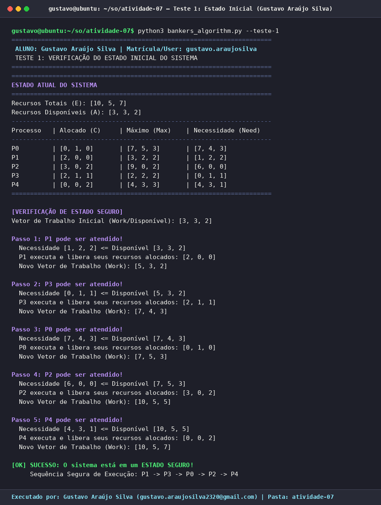
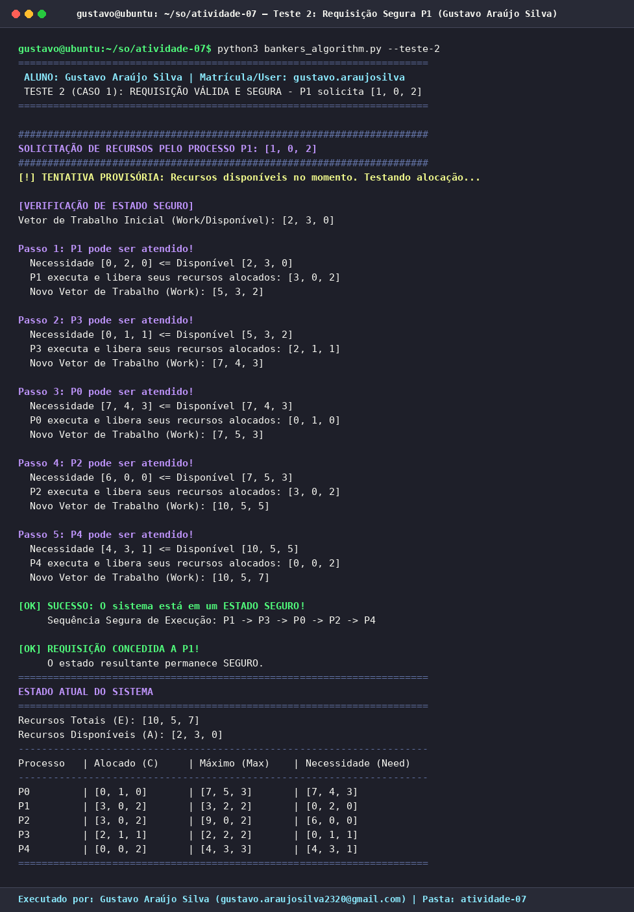
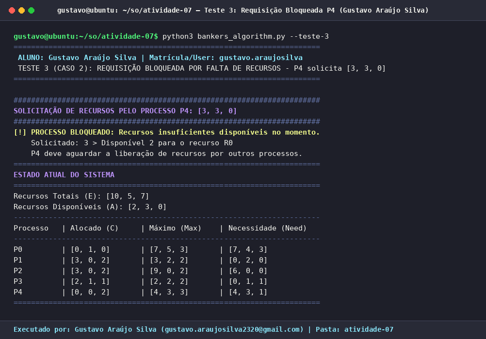
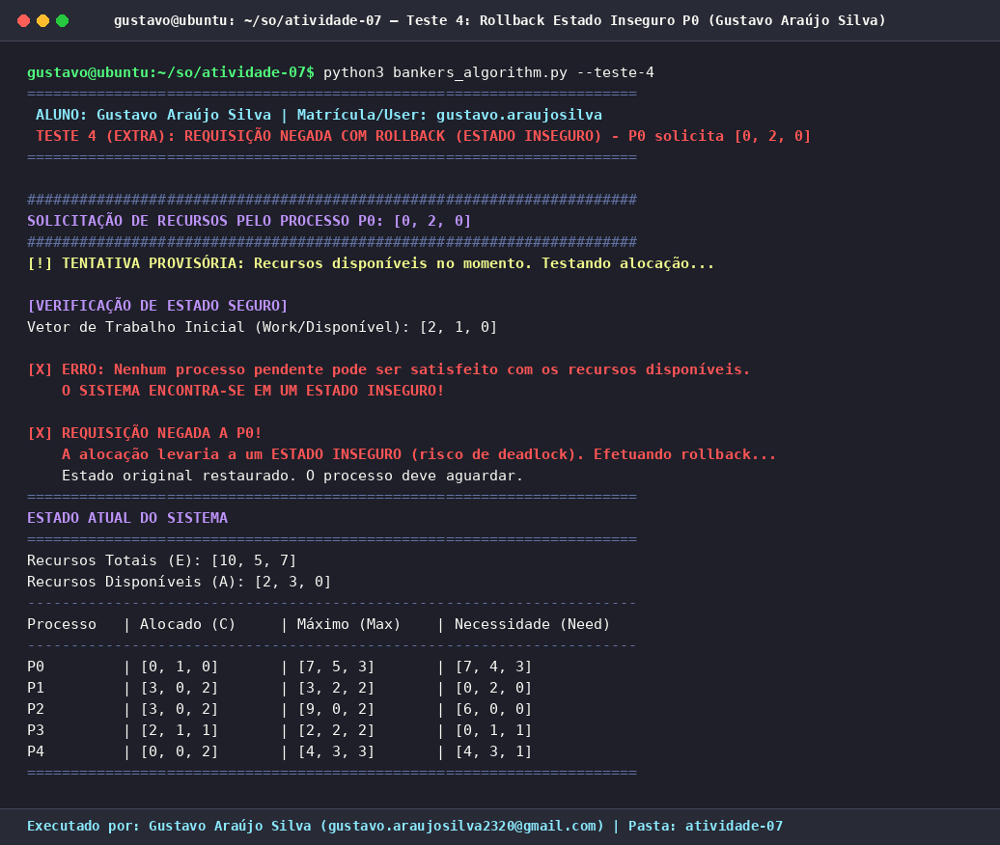

# Atividade 07 — Simulador do Algoritmo do Banqueiro (Dijkstra)

**Aluno:** Gustavo Araújo Silva  
**Disciplina:** Sistemas Operacionais  
**Referência Base:** Capítulo 6 — *Sistemas Operacionais Modernos* (Tanenbaum & Bos)

---

## 📌 Visão Geral do Algoritmo e Estruturas de Dados

O **Algoritmo do Banqueiro** é um algoritmo clássico de prevenção de *deadlocks* (impasses) projetado por Edsger Dijkstra. Ele avalia cada solicitação de recursos simulando provisoriamente a alocação e verificando se o estado resultante permanece **SEGURO** — isto é, se existe ao menos uma sequência de execução na qual todos os processos consigam obter os recursos de que necessitam, concluir sua execução e liberar seus recursos.

### Configuração Inicial do Sistema
* **Processos ($n = 5$):** `P0, P1, P2, P3, P4`
* **Tipos de Recursos ($m = 3$):** `R0, R1, R2`
* **Vetor de Recursos Existentes/Totais ($E$):** `[10, 5, 7]`
* **Soma dos Recursos Alocados ($\sum C$):** `[7, 2, 5]`
* **Vetor de Recursos Disponíveis Inicial ($A = E - \sum C$):** `[3, 3, 2]`

| Processo | Alocado ($C$) | Máximo Declarado ($Max$) | Necessidade ($Need = Max - C$) |
| :---: | :---: | :---: | :---: |
| **P0** | `[0, 1, 0]` | `[7, 5, 3]` | `[7, 4, 3]` |
| **P1** | `[2, 0, 0]` | `[3, 2, 2]` | `[1, 2, 2]` |
| **P2** | `[3, 0, 2]` | `[9, 0, 2]` | `[6, 0, 0]` |
| **P3** | `[2, 1, 1]` | `[2, 2, 2]` | `[0, 1, 1]` |
| **P4** | `[0, 0, 2]` | `[4, 3, 3]` | `[4, 3, 1]` |

---

## 🧪 Explicação Detalhada dos Testes e Saídas Geradas

### 1. Teste 1: Verificação do Estado Inicial do Sistema
* **Objetivo:** Calcular a matriz de Necessidade (`Need`) e o vetor de Recursos Disponíveis (`Available`), verificando se a configuração inicial do sistema é segura.
* **Explicação Passo a Passo da Execução (`Work` inicial = `[3, 3, 2]`):**
  1. **Passo 1 (`P1`):** Necessidade de `P1` (`[1, 2, 2]`) $\le$ Disponível (`[3, 3, 2]`). `P1` executa e devolve `[2, 0, 0]`, atualizando `Work` para `[5, 3, 2]`.
  2. **Passo 2 (`P3`):** Necessidade de `P3` (`[0, 1, 1]`) $\le$ Disponível (`[5, 3, 2]`). `P3` executa e devolve `[2, 1, 1]`, atualizando `Work` para `[7, 4, 3]`.
  3. **Passo 3 (`P0`):** Necessidade de `P0` (`[7, 4, 3]`) $\le$ Disponível (`[7, 4, 3]`). `P0` executa e devolve `[0, 1, 0]`, atualizando `Work` para `[7, 5, 3]`.
  4. **Passo 4 (`P2`):** Necessidade de `P2` (`[6, 0, 0]`) $\le$ Disponível (`[7, 5, 3]`). `P2` executa e devolve `[3, 0, 2]`, atualizando `Work` para `[10, 5, 5]`.
  5. **Passo 5 (`P4`):** Necessidade de `P4` (`[4, 3, 1]`) $\le$ Disponível (`[10, 5, 5]`). `P4` executa e devolve `[0, 0, 2]`, atualizando `Work` para `[10, 5, 7]` (igual ao vetor total $E$).
* **Saída Gerada:** O sistema confirma que está em um **ESTADO SEGURO** com a sequência segura de execução: **`P1 -> P3 -> P0 -> P2 -> P4`**.



---

### 2. Teste 2 (Caso 1): Requisição Válida e Segura pelo Processo `P1` (`[1, 0, 2]`)
* **Objetivo:** Avaliar a solicitação do vetor `Request = [1, 0, 2]` feita pelo processo `P1`.
* **Validações Realizadas pelo Algoritmo:**
  1. **Verificação de Limite Máximo (`Request <= Need[P1]`):** `[1, 0, 2] <= [1, 2, 2]` (Válido — não excede o máximo declarado).
  2. **Verificação de Disponibilidade (`Request <= Available`):** `[1, 0, 2] <= [3, 3, 2]` (Válido — há recursos livres suficientes).
  3. **Alocação Provisória:**
     * `Available` passa de `[3, 3, 2]` para `[2, 3, 0]`.
     * `Allocation[P1]` passa de `[2, 0, 0]` para `[3, 0, 2]`.
     * `Need[P1]` passa de `[1, 2, 2]` para `[0, 2, 0]`.
  4. **Teste de Segurança no Estado Provisório:** Iniciando com `Work = [2, 3, 0]`, o processo `P1` (cuja necessidade residual é `[0, 2, 0]`) pode ser imediatamente atendido, devolvendo `[3, 0, 2]` e elevando `Work` para `[5, 3, 2]`. A partir daí, a sequência **`P1 -> P3 -> P0 -> P2 -> P4`** conclui sem impedimentos.
* **Saída Gerada:** **REQUISIÇÃO CONCEDIDA A `P1`!** O estado provisório é efetivado e o vetor `Available` passa a ser `[2, 3, 0]`.



---

### 3. Teste 3 (Caso 2): Requisição Bloqueada por Insuficiência de Recursos pelo Processo `P4` (`[3, 3, 0]`)
* **Objetivo:** Avaliar a solicitação do vetor `Request = [3, 3, 0]` feita pelo processo `P4` após a concessão anterior a `P1`.
* **Validações Realizadas pelo Algoritmo:**
  1. **Verificação de Limite Máximo (`Request <= Need[P4]`):** `[3, 3, 0] <= [4, 3, 1]` (Válido — `P4` realmente declarou que poderia precisar desses recursos).
  2. **Verificação de Disponibilidade (`Request <= Available`):** Compara-se o pedido `[3, 3, 0]` com o disponível atual `[2, 3, 0]`. Para o recurso `R0`, `P4` solicitou `3` unidades, mas há apenas `2` unidades disponíveis (`3 > 2`).
* **Saída Gerada:** **PROCESSO BLOQUEADO!** A requisição não pode ser atendida no momento por falta de recursos livres em `R0`. `P4` entra em espera e o estado do sistema permanece inalterado (`Available = [2, 3, 0]`).



---

### 4. Teste 4 (Caso Extra): Requisição Negada por Estado Inseguro e Rollback pelo Processo `P0` (`[0, 2, 0]`)
* **Objetivo:** Demonstrar na prática o mecanismo de **tentativa provisória seguida de *Rollback*** quando os recursos estão disponíveis fisicamente, mas sua entrega deixaria o sistema em **ESTADO INSEGURO** (risco de *deadlock*).
* **Validações Realizadas pelo Algoritmo:**
  1. **Verificação de Limite e Disponibilidade:** `P0` solicita `[0, 2, 0]`, que é menor que `Need[P0] = [7, 4, 3]` e menor que `Available = [2, 3, 0]`.
  2. **Alocação Provisória:** `Available` cai para `[2, 1, 0]`, `Allocation[P0]` sobe para `[0, 3, 0]` e `Need[P0]` passa a `[7, 2, 3]`.
  3. **Falha no Teste de Segurança:** Com `Work = [2, 1, 0]`, **nenhum processo** pode ser satisfeito:
     * `Need[P0] = [7, 2, 3]` (falta R0, R1, R2)
     * `Need[P1] = [0, 2, 0]` (precisa de 2 unidades de R1, mas só há 1!)
     * `Need[P2] = [6, 0, 0]` (precisa de 6 unidades de R0, mas só há 2!)
     * `Need[P3] = [0, 1, 1]` (precisa de 1 unidade de R2, mas há 0!)
     * `Need[P4] = [4, 3, 1]` (falta R0, R1, R2)
  4. **Execução do Rollback:** O algoritmo detecta o **ESTADO INSEGURO**, nega a requisição a `P0` e restaura imediatamente `Available = [2, 3, 0]`, `Allocation[P0] = [0, 1, 0]` e `Need[P0] = [7, 4, 3]`.



---

## 🚀 Como Executar Localmente

```bash
cd atividade-07
python3 bankers_algorithm.py
```
